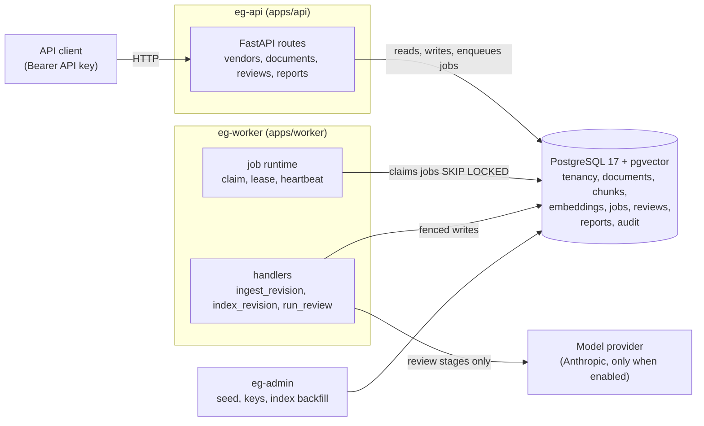
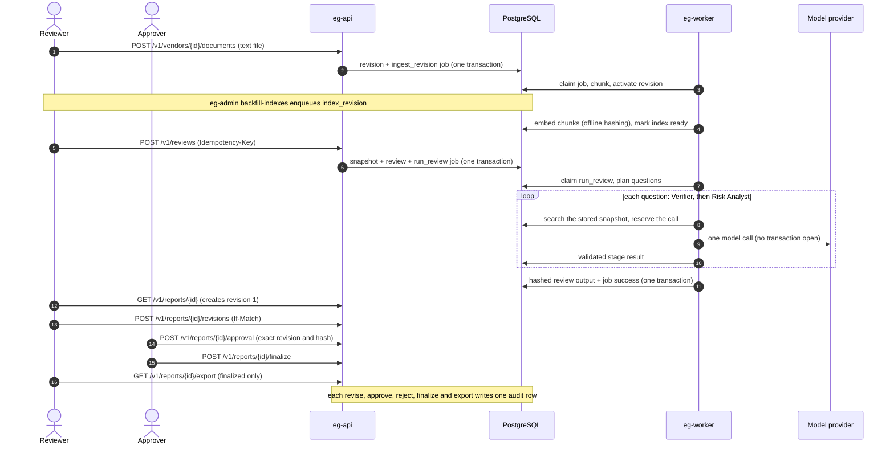

# Architecture

This guide explains how EvidenceGuard fits together. Each section names the modules that
implement what it describes, so every statement can be checked against the code. The design
reasons are in the [decision records](decisions/); this page describes what the code does.

## Components

EvidenceGuard is one installable Python 3.12 distribution (`pyproject.toml`) with two
processes and five shared packages ([ADR-0001](decisions/0001-packaging-and-layout.md)). Both
processes talk only to PostgreSQL 17 with the pgvector extension; they never call each other.

| Component | Where | What it does |
|---|---|---|
| API | `apps/api/evidenceguard_api` | FastAPI app built by `app.create_app`; routes in `vendors.py`, `documents.py`, `reviews.py`, `reports.py`, `me.py`, `readiness.py`; started by `eg-api` (`__main__.py`). |
| Admin command | `apps/api/evidenceguard_api/admin.py` | `eg-admin seed-demo`, `create-key`, `revoke-key`, `backfill-indexes`. |
| Worker | `apps/worker/evidenceguard_worker` | `eg-worker` (`__main__.py`) runs one job at a time (`runtime.py`) from an immutable registry (`registry.py`, `handlers.py`). |
| Domain | `packages/domain/evidenceguard_domain` | Pure, validated values and rules: actors and roles (`context.py`), jobs (`jobs.py`), retrieval and fusion (`retrieval.py`), provenance (`provenance.py`), report content and approval (`report_content.py`, `review_report_approval.py`). No I/O. |
| Persistence | `packages/persistence/evidenceguard_persistence` | SQLAlchemy models (`models.py`), Alembic migrations `0001` to `0009` (`migrations/versions/`), settings (`settings.py`) and every database operation. |
| Retrieval | `packages/retrieval/evidenceguard_retrieval` | Deterministic chunker (`chunking.py`), embedding contracts and the offline `HashingEmbedder` (`embeddings.py`), a Voyage adapter (`voyage.py`, with its transport in `apps/worker/evidenceguard_worker/voyage_http.py`; neither is wired into a process), and the synthetic retrieval-evaluation corpus tools (`evaluation/`). |
| Agents | `packages/agents/evidenceguard_agents` | Review templates and versioned prompts (`templates.py`, `prompts.py`, `data/`), the deterministic Planner (`planner.py`), request assembly (`assembly.py`), the model-provider protocol (`providers.py`), the Anthropic adapter (`anthropic.py`), report building (`report.py`) and export rendering (`report_export.py`). |
| Observability | `packages/observability/evidenceguard_observability` | JSON log lines with reviewed event names and allowlisted fields only (`jsonlog.py`), request IDs (`context.py`) and closed provider-call spans (`provider_spans.py`). |

The packages are layered: the domain imports nothing from the others, persistence may not import
the agents package (so export rendering is passed to it as a callback, see
`persistence/reports.py`), and the API may not import the worker. `tests/test_packaging.py`
enforces the import rules.

A retrieval evaluation over the synthetic corpus in `sample_data/` exists as test-only code
(`apps/worker/evidenceguard_worker/evaluation.py`, [ADR-0017](decisions/0017-retrieval-evaluation.md));
it has no installed command. No live evaluation of the review path has been run.

## The review pipeline, end to end

1. **Upload.** `POST /v1/vendors/{vendor_id}/documents` (`apps/api/evidenceguard_api/documents.py`)
   streams a multipart body through a bounded parser (`uploads.py`: at most 2 MiB of file
   content, `text/plain` or `text/markdown`, strict UTF-8, no temporary files). The revision
   keeps the exact uploaded bytes with their SHA-256 (`persistence/documents.py`); identical
   bytes return the existing revision. The revision and its `ingest_revision` job commit in one
   transaction ([ADR-0011](decisions/0011-document-api.md)).
2. **Ingestion and chunking.** The `ingest_revision` handler (`worker/ingest.py`) runs the
   deterministic chunker `text-md-v1` (`retrieval/chunking.py`), writes chunks with exact
   source spans (`persistence/chunks.py`) and activates the revision only after verifying the
   complete chunk set, in the same transaction as the job's success
   ([ADR-0010](decisions/0010-document-ingestion.md)). Chunk IDs are `uuid5` values of tenant,
   revision, chunker version and ordinal (`domain/chunks.py`, `chunk_id`).
3. **Embeddings.** `eg-admin backfill-indexes` enqueues `index_revision` jobs for a tenant's
   active revisions (`persistence/indexing.py`). The handler (`worker/indexing.py`) embeds
   chunks with the only provider registered in production, the offline `HashingEmbedder`
   (`HASH_IDENTITY`, 1024 dimensions, in `retrieval/embeddings.py`). It hashes words; it is a
   lexical baseline, not a semantic model. Vectors are stored with pgvector
   (`persistence/embeddings.py`, migration `0005`) and the index is marked ready atomically
   with the job's success ([ADR-0015](decisions/0015-revision-indexing.md)).
4. **Snapshot and hybrid retrieval.** Creating a review captures a snapshot of the vendor's
   active revisions (`persistence/retrieval.py`, `capture_in_transaction`) and refuses the
   capture when an active revision has no chunk set or no ready index (`SnapshotNotReadyError`,
   returned as 409). Retrieval runs only against that stored snapshot
   (`worker/retrieval.py`, `search_snapshot`): a lexical channel (PostgreSQL full text,
   `ts_rank_cd`) and an exact vector channel, fused by reciprocal-rank fusion with constant 60
   (`domain/retrieval.py`, `fuse`). Ties are ordered by ascending chunk ID, in each channel's
   SQL and in the fusion ([ADR-0016](decisions/0016-snapshot-retrieval.md)).
5. **Review creation.** `POST /v1/reviews` (`api/reviews.py`) needs an `Idempotency-Key`. It
   loads the pinned template and prompts, pins the configured model id into the review's
   configuration digest, and calls `create_review` (`persistence/reviews.py`) so the snapshot,
   the review and its `run_review` job commit together. When reviews are not configured it
   returns 503 and queues nothing. A tenant may have at most `EG_REVIEW_MAX_IN_FLIGHT`
   (default 2) reviews queued or running; over the cap it returns 429
   ([ADR-0027](decisions/0027-production-review-path.md)).
6. **Multi-agent review with evidence.** The `run_review` handler (`worker/review.py`) is
   registered only when the worker has a complete review configuration
   (`worker/review_wiring.py`). It plans one question per template question with the
   deterministic Planner (no model call, `agents/planner.py`), then for each question runs two
   model stages in order: the **Verifier**, which answers from the retrieved passages with
   exact quotations, and the **Risk Analyst**, which states findings citing only the validated
   quotations (prompts in `agents/data/prompts/`). Document text is sent to the model as JSON
   data, never as instructions (`agents/assembly.py`). Every reply is schema-validated, and
   every quotation must occur in a chunk retrieved for that question
   (`domain/provenance.py`, `match_quote`); the evidence status is derived by code, not taken
   from the model (`derive_status`). Each call is reserved in the database before it is made,
   and no call runs inside a database transaction (`persistence/review_stages.py`,
   [ADR-0023](decisions/0023-review-stage-persistence.md), [ADR-0025](decisions/0025-review-orchestration.md)).
7. **Hashed, write-once review output.** After a trusted reload of every stage, the handler
   builds the report content (`agents/report.py`), rechecks it against its sources, renders
   Markdown and writes one `review_outputs` row with the canonical bytes and their SHA-256
   (`persistence/review_outputs.py`, `write_review_output`), inside the transaction that records
   the job's success. A unique key allows one output per review and job; no code path updates
   it. `GET /v1/reviews/{review_id}/result` returns it.
8. **Report revisions.** The first access to `/v1/reports/{report_id}` (the report ID is the
   review ID) creates revision 1 from the output row (`persistence/reports.py`). A revision
   records a disposition per finding (`open`, `accepted`, `dismissed` with a note) and notes; it
   never edits the machine findings, and its hash covers the output's SHA-256
   (`domain/review_report_approval.py`, [ADR-0028](decisions/0028-approval-gate-and-export.md)).
   Every mutation is compare-and-set: it needs `If-Match` with the ETag `"r{n}-{sha}"` and runs
   under a row lock.
9. **Approval gate.** `POST /v1/reports/{id}/approval` approves or rejects one exact revision
   number and hash. Only the approver role may decide, never on a revision they authored, and a
   rejection needs a comment. A new revision removes the effective approval.
10. **Finalize.** `POST /v1/reports/{id}/finalize` requires an approval of the current
    revision and hash.
11. **Export.** `GET /v1/reports/{id}/export` works only for a finalized report. It renders
    Markdown or JSON from the stored, digest-checked revision and output bytes
    (`agents/report_export.py`), with a fixed disclaimer, and never re-reads stage rows.

## Data model and tenancy

Tables are defined in `persistence/models.py` and created by migrations `0001` to `0009`:

| Area | Tables |
|---|---|
| Tenancy and access | `tenants`, `users`, `api_keys`, `vendors` |
| Jobs | `jobs` |
| Documents | `documents`, `document_revisions`, `chunk_sets`, `chunks` |
| Embeddings | `embedding_profiles`, `embedding_indexes`, `chunk_embeddings` |
| Reviews | `reviews`, `review_bindings`, `review_excluded_revisions`, `review_plan_questions`, `review_question_evidence`, `review_stage_calls`, `review_stage_results`, `review_outputs` |
| Reports and audit | `reports`, `report_revisions`, `report_decisions`, `report_finalizations`, `audit_events` |

Every tenant-owned table carries `tenant_id`, and references between tenant-owned rows are
composite foreign keys that include `tenant_id`, so a row cannot point at another tenant's row
([ADR-0004](decisions/0004-persistence-foundation.md)). The API takes the tenant only from the
authenticated key (`api/auth.py`), never from a request body, header or query, and every query
filters by it; another tenant's object is a 404, like a missing one. PostgreSQL row-level
security is not used.

## Durable job queue

Jobs live in the `jobs` table ([ADR-0007](decisions/0007-durable-job-core.md),
`persistence/jobs.py`). Enqueue runs inside the caller's transaction, so a job commits with the
work that created it. A worker claims one job with `SELECT ... FOR UPDATE SKIP LOCKED`, holds a
lease that it renews by heartbeat (`worker/heartbeat.py`), and makes every effect inside a fenced
transaction that locks the job row and checks the `(job, worker, attempt)` token and the lease
against fresh database time. Expired leases are reclaimed. A handler's final effects and the
job's success commit together (`finish=True`). The worker runs one handler at a time and stops
gracefully on SIGINT or SIGTERM ([ADR-0008](decisions/0008-worker-runtime.md)). Registered kinds:
`ingest_revision`, `index_revision` and, only with a review configuration, `run_review`
(`worker/handlers.py`).

## Security boundaries and roles

- **Authentication.** API keys `egk_<prefix>_<secret>`; only the prefix and the SHA-256 of the
  secret are stored (`persistence/credentials.py`, [ADR-0005](decisions/0005-api-key-authentication.md)).
  `eg-admin create-key` prints a key once.
- **Roles** (`domain/context.py`): `reviewer` and `approver` may use vendors, documents,
  reviews and reports; only `approver` may approve, reject or finalize; `admin` is an operator role with no access to those routes (keys are managed with the `eg-admin` command)
  and gets 403 on these routes. There is no admin bypass.
- **Model provider key.** `EG_ANTHROPIC_API_KEY` is read by the worker only
  (`worker/review_wiring.py`). The API never reads it and never calls a model.
- **Untrusted input.** Uploads are bounded and strictly decoded (`api/uploads.py`). Document text
  reaches the model only as JSON data, and model replies are validated and provenance-checked
  before anything is stored.
- **Errors and logs.** Errors are `application/problem+json` with fixed messages that never echo
  submitted values (`api/problems.py`); log lines carry reviewed event names and allowlisted
  fields only, never request bodies, document text or exception messages
  (`observability/jsonlog.py`, [ADR-0002](decisions/0002-request-ids-logging-and-errors.md)).
  Provider-call spans hold closed metadata only (`observability/provider_spans.py`).
- **Settings** come from the process environment only; no `.env` file is read
  (`persistence/settings.py`).

The full threat model is in [threat-model.md](threat-model.md).

## Audit trail

Every report revise, approve, reject, finalize and export writes one `audit_events` row with
the actor, the revision number and its hash (and for an export, the format and the SHA-256 of
the exact body) in the same transaction as the change (`persistence/reports.py`). Migration
`0009` installs the trigger function `eg_reject_append_only_change()`, which rejects UPDATE,
DELETE and TRUNCATE on `report_revisions`, `report_decisions`, `report_finalizations` and
`audit_events`, and DELETE and TRUNCATE on `reports`. A table owner or superuser can disable
these triggers, so the protection holds only while the runtime database role does not own the
tables. Review stage rows record every reserved and completed model call
(`review_stage_calls`, `review_stage_results`).
